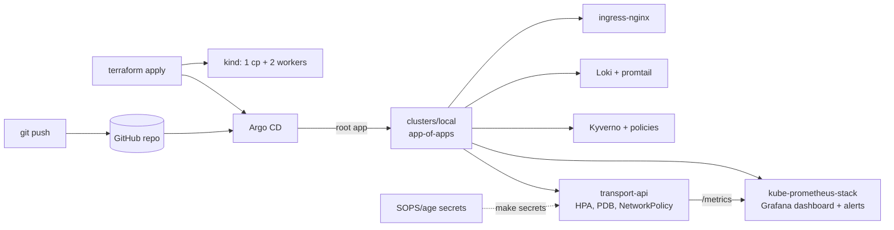

# gitops-platform

[](https://github.com/DYyyyDYyy/gitops-platform/actions/workflows/ci.yaml)

A local Kubernetes platform with no cloud account. Terraform builds a 3-node kind cluster and installs Argo CD. From then on, everything is synced from this repo: ingress-nginx, kube-prometheus-stack, Loki + promtail, Kyverno policies, and a demo FastAPI + PostgreSQL app ([rest-api-transport-firm](https://github.com/DYyyyDYyy/rest-api-transport-firm)).



## Quick start

Requirements: Docker with about 6 GB RAM free, and free ports 80/443.

```bash
make tools   # pinned CLIs -> ~/.local/bin (.tool-versions)
make up      # cluster -> Argo CD -> all apps Healthy (about 7-10 min)
make status  # URLs and logins
make test    # lint + live checks (apps healthy, /health, Kyverno blocks a bad pod, dashboard exists)
make down    # delete everything
```

`make up LOCAL_GIT=1` has Argo CD sync from this working copy's commits instead of GitHub.

| URL | What |
|---|---|
| http://api.localhost/docs | demo API (Swagger) |
| http://argocd.localhost | Argo CD |
| http://grafana.localhost | Grafana, dashboard "Transport API" |

## Layout

| Path | Contents |
|---|---|
| `terraform/` | kind cluster, PSA-labelled namespaces, Argo CD + root app (local state) |
| `clusters/local/` | app-of-apps chart: one Application per entry, ordered by sync waves |
| `platform/` | values for upstream charts, plus the dashboard JSON and PrometheusRule |
| `apps/transport-api/` | app chart: probes, HPA, PDB, NetworkPolicy, ServiceMonitor, PostgreSQL |
| `policies/` | Kyverno `ValidatingPolicy` (no `latest`, requests/limits, non-root) + `kyverno test` |
| `secrets/` | SOPS-encrypted Secrets (age key not in git) |
| `image/` | builds the API at a pinned commit and adds `/metrics` |

CI runs terraform fmt/validate/plan, helm lint, kubeconform, kyverno test and promtool tests. It then runs an end-to-end job: kind in GitHub Actions, `make up` at the pushed commit, and the smoke tests.

ADRs: [GitOps](docs/adr/0001-gitops.md), [app-of-apps](docs/adr/0002-app-of-apps.md), [SOPS not Vault](docs/adr/0003-sops-not-vault.md), [kind not cloud](docs/adr/0004-kind-not-cloud.md).

## What is not here, and how it would look in AWS

- **EKS** instead of kind, through the `terraform-aws-modules/eks` module with managed node groups and a remote S3 backend for state.
- **IRSA / EKS Pod Identity** for pod IAM roles, in place of static credentials.
- **AWS Load Balancer Controller (ALB)** with ACM certificates, in place of ingress-nginx on hostPort.
- **RDS for PostgreSQL** in place of the in-cluster StatefulSet. Secrets would come from AWS Secrets Manager via External Secrets.
- **ECR** in place of `kind load`, with image builds and pushes from CI.
